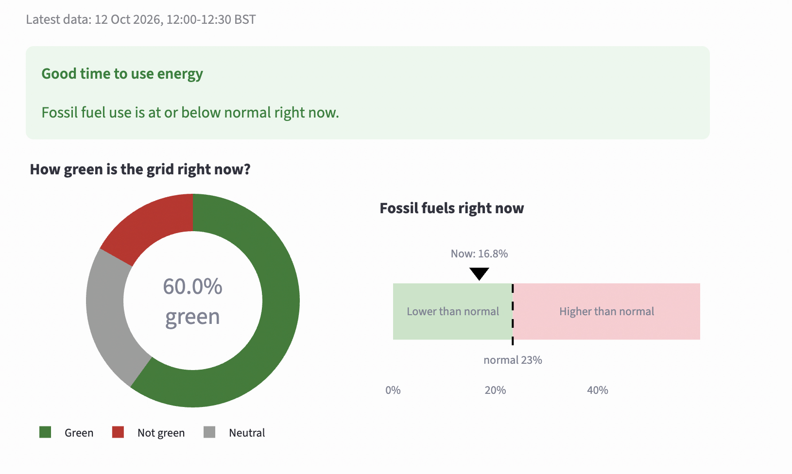

# How green is the grid?

A small widget that shows how green Great Britain's electricity is right now, and suggests reducing or delaying energy use when fossil fuel use is higher than normal. It uses live generation data from Elexon.

**Live app:** [How Green is the Grid](https://how-green-is-the-grid-bnfdvgikqjnaj4zftm6jqh.streamlit.app/)

To run the app locally, follow the steps in [Quick start](#quick-start) below.



## Quick start

You need Python 3.11 or newer and an internet connection (for live data).

**macOS / Linux**

```bash
python3 -m venv .venv
source .venv/bin/activate
pip install -r requirements.txt
streamlit run streamlit_app.py
```

**Windows (PowerShell)**

```powershell
py -m venv .venv
.venv\Scripts\activate
pip install -r requirements.txt
streamlit run streamlit_app.py
```

The widget opens in your browser at http://localhost:8501.

To run the tests (make sure your virtual environment is activated):

```bash
python -m pytest
```

The tests never call the live API, so they work offline.

## What you'll see

- **A banner** with the advice: "Good time to use energy" or "Try to reduce or delay your energy use".
- **A donut chart** of the current mix (green, neutral, not green), with the green percentage in the middle.
- **A fossil fuel scale** showing where the current not green percentage sits against "normal".
- **The time period** the data covers, in UK time.

To use the sample data from the brief instead of live data, set `data_source = "data/sample.json"` in `config.toml`.

## Approach

For each half-hour of data:

1. **Clip negatives to 0.** Negative values (exports and pumped storage charging) are counted as 0.
2. **Sort into three groups.** Each fuel type is green, not green or neutral, using the brief's table (stored in `config.toml`). The megawatts in each group are then added up.
3. **Work out each group's share.** Each group's megawatts are divided by the total supply to give the green, not green and neutral percentages.
4. **Compare the not green percentage with a baseline.** If it is above the baseline, fossil fuel use is higher than normal and the widget suggests reducing usage.

With the brief's sample this gives 76.8% green, 13.4% neutral and 9.8% not green.

### What counts as "normal"

The baseline can be set in `config.toml` in one of two ways.

**Dynamic (default).** The average not green percentage over every half-hour in the 7 days before now. Each half-hour counts equally, because the user is deciding *when* to use energy, so "now" is compared with a typical half-hour. I use all times of day rather than only the same time of day, so the dirtiest periods (such as early evening) are flagged and usage is nudged towards cleaner times.

For example, imagine for simplicity that the history is just the three half-hours before now, instead of 7 days:

| Half-hour | Not green | Total | Not green % |
|---|---|---|---|
| 16:30 | 300 MW | 1,000 MW | 30% |
| 17:00 | 150 MW | 1,000 MW | 15% |
| 17:30 | 900 MW | 3,000 MW | 30% |
| **18:00 (now)** | 700 MW | 2,000 MW | **35%** |

Normal = (30 + 15 + 30) / 3 = **25%**. Each half-hour counts once, however much electricity was used, and "now" is not part of its own baseline. Now is 35%, above 25%, so the widget suggests waiting. The real calculation does exactly this across every half-hour of the previous 7 days.

**Static (fallback).** A fixed 27%, taken from NESO's annual review of 2025 ([Britain's Energy Explained: 2025 Review](https://www.neso.energy/news/britains-energy-explained-2025-review)). It reports that gas supplied 26.8% of Britain's electricity that year. Coal generation had ended, so gas was effectively the only fossil fuel in use, making 27% a research-based estimate of a typical fossil fuel share. The static value is used if the dynamic baseline can't be calculated, for example when reading the sample file, which has no history.

## Decisions and assumptions

| Decision | Why |
|---|---|
| Negative values count as 0 | A negative value means electricity leaving the grid (exported abroad, or used to pump water into storage), not electricity being supplied. Counting it as 0 also keeps every percentage between 0 and 100. |
| Imports are included in the total as neutral | Imported electricity is part of the supply people in GB are using. The brief lists interconnections as one of the sources supplying the grid, and rates them neutral. |
| A fuel type missing from the ratings counts as neutral | Keeps real supply in the total without skewing the result. A warning is logged for the developer to add it to `config.toml`; it doesn't affect what the user sees. |
| Whether now is a good time to use energy is based on the not green percentage | The brief asks to encourage reducing usage "when fossil fuel use is higher than normal", and the not green fuel types are the fossil fuels. If the not green percentage right now is above normal (see the baseline above), the widget suggests waiting. |
| "Normal" is based on the last 7 days | It covers a full week (weekdays and the weekend) while still reflecting current weather and season. It can be changed with `lookback_days` in `config.toml`. |
| Exactly at the baseline counts as normal | Only strictly above is "higher than normal". |
| The static baseline is 27% | Based on NESO's 2025 review, where gas (effectively the only fossil fuel still generating) supplied 26.8% of Britain's electricity. It's approximate, as NESO also counts small local solar and wind that Elexon's data doesn't include. |
| Times are shown in UK time | Elexon's data is in UTC, but users are in the UK. Converting means times are right in both GMT and BST. |
| The widget shows the latest published half-hour | Elexon publishes each half-hour after it ends, so the data is usually 15 to 45 minutes behind. The time shown makes this clear. |
| If the API fails, the widget says so | It never falls back to the sample, because old data shown as live would be misleading. |

The API is called with `includeNegativeGeneration=true`. By default it leaves negative values out, and the brief's sample was clearly fetched with them included, so this keeps live data in the same shape as the sample.

## Project structure

```
core/
  config.py          reads config.toml
  data.py            loads the sample file or fetches from the Elexon API
  calculations.py    all calculations: percentages, baseline, UK time
  summary.py         load_summary(): the one function the UI calls
streamlit_app.py     the page (display only, no calculations)
config.toml          settings: data source, baseline, fuel ratings
data/sample.json     the sample data from the brief
tests/               pytest tests for everything in core/
```

All logic lives in `core/`, so the Streamlit page could be replaced by a different frontend without changing any calculations.

`api/` and `react_app/` are the second version, described below.


## Proof of concept: next-hour prediction (Just for Fun)

This wasn't part of the brief, so it isn't in the widget. As a proof of concept, I built a simple logistic regression model that predicts whether the next hour (the next two half-hours) will have a lower not green percentage than now. This could tell users whether it's worth waiting before using energy.

- **Model Inputs:** the current not green percentage, how much it changed over the last 30 minutes and the last 2 hours, and the time of day.
- **Result:** trained on a year of Elexon data, with the final 30 days held back for testing. It gets about 71% accuracy, against about 50% for a simple mode baseline.

**The code is in its own folder, `next_hour_forecast/`:**

```
next_hour_forecast/
  prepare_waiting_data.py   downloads a year of Elexon data and builds the training set
  train_waiting_model.py    trains and tests the model, saves it to waiting_model.json
  waiting_model.json        the trained model (included, so retraining is optional)
  ml_prediction.py          makes a prediction from the saved model
```

**To run it**, from the project folder with the virtual environment activated (everything it needs is in `requirements.txt`):

1. **Go into the folder:**
   ```bash
   cd next_hour_forecast
   ```
2. **See an example prediction** from the included model:
   ```bash
   python ml_prediction.py
   ```
3. **Optional: retrain the model.** Download the data (about a minute), then train and test it. This prints the accuracy and F1 score and overwrites `waiting_model.json`:
   ```bash
   python prepare_waiting_data.py
   python train_waiting_model.py
   ```

## Second version: React + FastAPI

The Streamlit app above is the main solution. With extra time, I used the project to learn React, TypeScript and FastAPI by building a second frontend on the same, unchanged `core/`.

**How it fits together:** the React page asks the API for data, and the API uses the same `core/` code as the Streamlit app.

```
browser (React)  --HTTP-->  api/ (FastAPI)  --imports-->  core/
```

**Version 2 adds two new folders to the same project:**

```
core/              shared with version 1 (unchanged)
api/               new
  main.py          the API: GET /api/summary, calls core/ (cached for 5 minutes)
react_app/         new
  src/App.tsx      the page: banner, donut chart and fossil fuel scale (Recharts)
  src/index.css    the styles
  vite.config.ts   connects the page to the API while it runs
  package.json     the React app's dependencies
```

To run it you need Python 3.11+ and [Node.js](https://nodejs.org) 18+.

1. **Set up Python** (skip if you've already done the Quick start):
   ```bash
   python3 -m venv .venv
   source .venv/bin/activate      # Windows: .venv\Scripts\activate
   pip install -r requirements.txt
   ```
2. **Start the API** in that same terminal, from the project folder:
   ```bash
   uvicorn api.main:app --reload
   ```
   Leave it running.
3. **Start the React page** in a second terminal:
   ```bash
   cd react_app
   npm install
   npm run dev
   ```
4. **Open http://localhost:5173** in your browser.

The API has one endpoint, `GET /api/summary`, which returns the same summary the Streamlit page uses.
